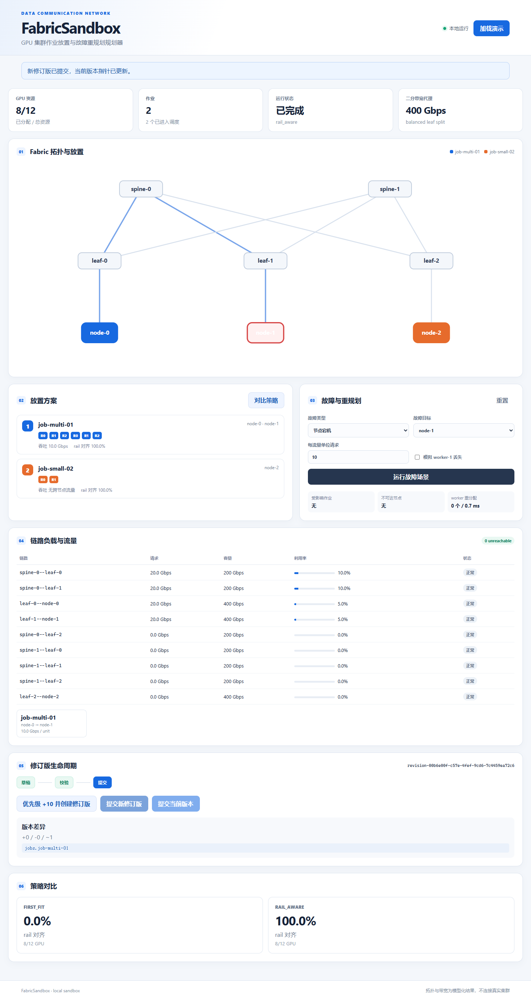

> 本文件是原项目阶段记录。当前验证边界和运行方法请先看 [复核与运行说明](review-handoff.md)。

# FabricSandbox 最终交付与运行说明

## 当前完成范围

项目已经完成 S0-S12 的 MVP 闭环：

- 1024 GPU 拓扑生成与语义校验。
- first-fit 与 rail-aware 放置。
- ring all-reduce 与 all-to-all 抽象流量。
- 路径、链路负载、吞吐代理、leaf 超订比和二分带宽代理。
- 链路、交换机、节点故障与最小范围重规划。
- 草稿、校验、提交、不可变哈希和版本 diff。
- 多 worker 分片、结果合并和 worker 丢失重分配。
- FastAPI、SQLite 本地持久化、PostgreSQL 适配器与 NATS worker。
- React/SVG 工作台和完整交互演示。

## 本地启动

首次或前端源码变化后：

```powershell
Push-Location apps\web
pnpm install
pnpm build
Pop-Location
```

启动：

```powershell
.\.venv\Scripts\python.exe scripts\start_gateway.py
```

浏览器打开：

```text
http://127.0.0.1:8000/
```



API 文档：

```text
http://127.0.0.1:8000/docs
```

本地默认使用 `var/fabric_sandbox.db`，重启后修订版仍保留。

## 一键检查

```powershell
.\scripts\run_checks.ps1
```

该脚本执行环境检查、Python 测试、前端构建，并启动无头 Edge 完成加载、故障重规划、
策略对比、修订版 diff 和提交。

## Docker Compose

安装 Docker 后：

```powershell
docker compose -f infra\compose.yaml up --build
```

默认服务：

- `app`：FastAPI + 构建后的 React。
- `postgres`：PostgreSQL 16。
- `nats`：NATS 2.10 + JetStream。

可选启动两个 NATS evaluator：

```powershell
docker compose -f infra\compose.yaml --profile nats-workers up --build
```

当前开发机没有 Docker，因此 Compose 文件完成了静态配置和 YAML 校验，但未在本机
启动容器。无 Docker 时，本地 SQLite 路径和浏览器界面是正式可用路径。

## 六分钟演示

1. 打开首页，点击“加载 3 节点演示”。
2. 查看 SVG 拓扑、GPU 放置和初始吞吐。
3. 在故障面板选择 `node-1` 并运行故障场景。
4. 查看受影响作业和 node-1 → node-2 迁移建议。
5. 勾选 worker-1 丢失，验证 worker 重分配。
6. 点击“对比策略”，比较 first-fit 0% 与 rail-aware 100% 对齐率。
7. 点击“优先级 +10 并创建修订版”，查看 diff。
8. 提交新修订版并展示当前版本变化。

## 限制

- 网络是模型化等权流量仿真，不是报文级拥塞模拟。
- 默认演示使用三节点微型拓扑；1024 GPU 拓扑由生成器和测试覆盖。
- Compose/NATS/PostgreSQL 容器路径未在此无 Docker 环境实机启动。
- ILP、功耗优化和多租户配额属于文档中的扩展项。
