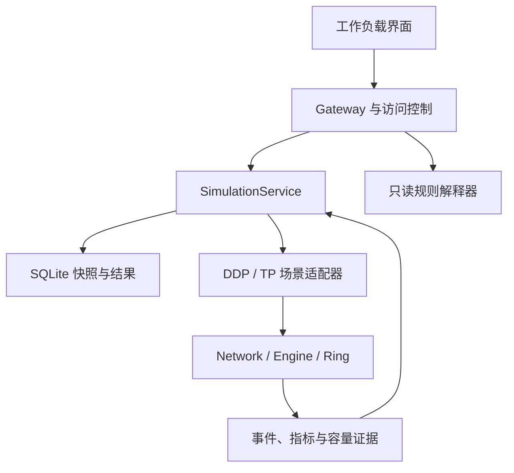
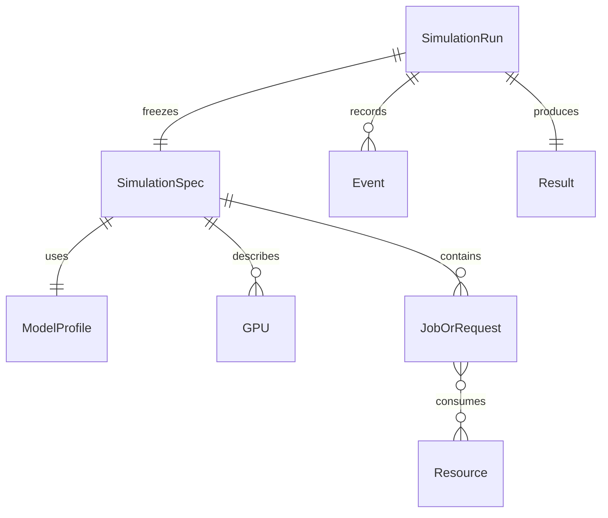
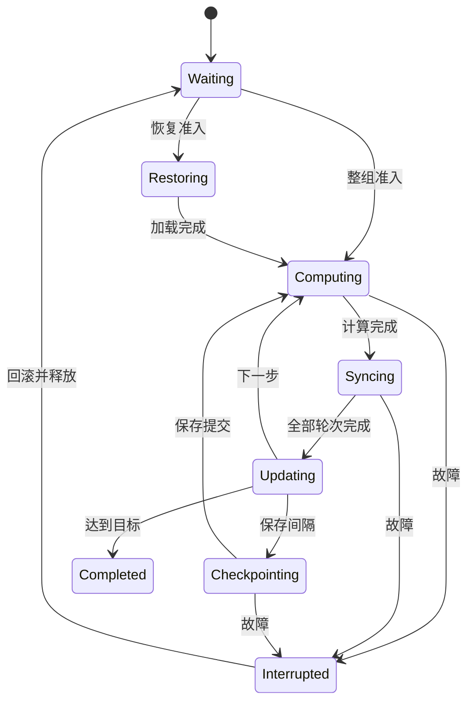

# FabricSandbox v2：GPU 通信网络规划与故障分析

> 工程报告草稿；对应 10 页 PDF。正式提交前填写成员和仓库信息。

## FabricSandbox v2 — GPU 通信网络规划与故障分析

课程：MAiNS（Models and Algorithms in Networks and Systems）｜课程项目工程报告草稿｜2026-11-02

Project Track：Option 4（须确认原提案获批情况）

Team Members：熊宇琛、马贤纯、王忻晔

Repository Link：［提交前填写 GitHub/GitLab 地址与提交号］

### Executive Summary

FabricSandbox 面向共享 GPU 集群中的通信规划与故障分析。重构以 GPT-2 Small 的同步数据并行训练为主场景，以 Qwen2.5-7B 的张量并行推理为第二种工作负载，建立“模型结构—通信数据—物理资源—执行状态—性能指标”的对应关系。系统不执行真实神经网络，而是在明确假设下模拟集合通信及其对资源和时间的影响。

项目处理三类复杂性：在结构层面，将场景语义与公共网络事件内核分开；在行为层面，用成组分配、同步依赖、检查点提交、执行轮次和不可变输入管理状态；在领域层面，分别刻画梯度、激活与 KV 数据，并执行单卡显存、固定并行度、共享 NIC 和机架上联等约束。界面提交后异步返回运行标识，SQLite 保存快照与结果，规则型 Assistant 引用原始事件解释等待、故障与拒绝。

当前 180 项自动化测试及 19 个实验情景通过，其中 178 项来自原基线、2 项用于验证 A/B/C 集成证据接口。B 在不同 Windows/Python 3.12.10 环境复现了全部仿真结果。A 在两张 RTX 3090 上完成了 GPT-2 单卡前后向、优化器、显存和两卡梯度 AllReduce 测量；C 完成了真实 HTTP、浏览器、权限、快照、只读解释和重启持久化验收。实验覆盖解析校验、放置、共享竞争、资源准入、检查点中断、TP 配置与 KV 拒绝以及副本故障。四卡 64 MiB 校验获得与手算一致的 8.053064 ms；合成 DDP 对照展示了不共享 GPU 的作业仍会因上联竞争而延迟。网络、部分恢复耗时和 Qwen 推理 profile 仍为 SYNTHETIC。

### 交付定位

此报告对应 v2 动态仿真路径。旧静态评估与 NATS 骨架保留为历史模块，不纳入当前主链的能力声明。成员姓名和职责已补入；远程仓库地址、固定提交号和现场录屏仍需团队完成。

## 1. System Domain & Problem Statement

目标问题：给定有限 GPU、拓扑、模型负载与故障轨迹，判断作业或推理部署是否可行，解释其通信瓶颈，并分析资源不足和故障之后的执行结果。规划的价值来自改变 GPU 放置所经过的物理资源，而非仅提高某个与训练时间未关联的“对齐率”。

| 场景 | 交换的数据与依赖 | 主要问题 |
| --- | --- | --- |
| DDP 训练（主线） | 各 rank 处理不同样本；同步梯度后才可提交逻辑训练步 | 显存与整组准入、共享链路、故障回滚及等待 |
| TP 推理（扩展基线） | 层内分片后汇总激活部分结果；prefill 与逐 token decode | 合法 TP、分片权重和 KV 准入、TTFT 与副本故障 |

### 运行规模与输入输出

基准拓扑为四个节点、每节点两卡、两个机架，单卡显存设为 24 GiB。节点网口、机架上联、本地共享通路分别设为 100/50/200 Gbps；它们是有效带宽输入，不是 3090 实测结果。跨机架路径消耗源 NIC、源机架上联、目的机架上联与目的 NIC；同节点流仍消耗有限本地带宽。

输入包括拓扑、模型 profile、作业或请求、放置、故障时刻、仿真截止时间。输出包括完成/拒绝/未完成状态、训练步与回滚、请求首 token 延迟、资源时间序列、原始事件和不变量检查。输入快照与模拟中的可变状态分别保存。

### 为什么朴素实现不足

若逐个作业独立计算再拼接结果，每个作业都可能获得整条共享上联，导致并发容量超用；若故障后只重新分配 GPU，旧计算完成事件可能推进已重启的作业；若用固定流速代表任意模型，则不能解释网络变化对训练或推理的影响。因此必须用统一资源账本、事件时钟及场景状态来协调依赖。

| 输入性质 | 来源口径 | 不可替代的验证 |
| --- | --- | --- |
| 模型/算法字节量 | DERIVED，由配置和公式推导 | 参数计数、分块与轮次手算 |
| 计算、恢复、有效带宽 | 当前多为 SYNTHETIC | 单因素敏感性；后续实测校准 |
| GPU 实际测量 | MEASURED：2 × RTX 3090，PyTorch 2.7.1+cu128 | 仅覆盖记录中的 GPT-2 profile、梯度 AllReduce 与两种 TP 小消息 |

## 2.1 High-Level Component Architecture

应用层负责提交、访问控制和记录；领域层决定何时开始/结束通信；内核只处理资源路径、活动流与事件。两个场景共享内核，避免各自维护一套不一致的带宽规则。

| 代码位置 | 职责 | 不能承担的职责 |
| --- | --- | --- |
| fabric_sim/core.py | 路径、流、容量分配、事件时钟、Ring 轮次 | 不决定检查点与请求重试策略 |
| fabric_sim/ddp.py / tp.py | 模型语义、资源准入、正常/故障状态 | 不各自重写物理链路容量 |
| fabric_sim/validation.py | 输入边界、规范化与 hash | 不把业务不可行当服务器异常 |
| gateway/simulation_api.py | 有界异步执行、SQLite、查询与解释 | 不承诺多协调器或断点续跑 |
| apps/web/workload.html | 编辑场景、展示指标和事件回放 | 不将仿真回放称为真实监控 |

网络采用聚合有效资源，尚无显式交换机图或多路径路由；当前 compact 与 first_fit 不能当作独立算法比较。当前服务使用单个 ThreadPoolExecutor 工作线程与有界等待名额。异步提交提高查询可用性，但不意味着多个情景已在多个机器上并行执行。仿真中的多个 GPU rank 也不等于服务工作线程。NATS 未接入 v2 主执行链，架构图不把它画为已运行的消息中间件。

## 2.2 Data Models & Schema Design

SimulationSpec 是一次实验的不可变输入；Job/Replica/Request 是领域实体；Resource 是可共享的容量实体。输入字段影响结果的修改必须产生新的运行。input_hash 用于输入识别，不能替代代码版本，因此归档仍须保留实现版本或提交号。

| 合同 | 关键字段 | 单位 / 规则 |
| --- | --- | --- |
| SimulationSpec | schema_version, scenario, topology, faults, horizon_ms | v2；scenario=ddp 或 tp；finite 数值 |
| DDP job | id, world_size, steps, checkpoint_interval, gpu_ids | 固定卡数；显式放置用于对照 |
| TP replica/request | tp_size, gpu_ids / arrival_ms, prompt_tokens, max_new_tokens | 每副本单请求；静态最大 KV 预留 |
| Transfer/Event | owner, epoch, size_bytes, path / time_ms, kind | 数据 bytes；时间 ms；带宽内部 bytes/s |
| SimulationResult | summary, events, resource_samples, invariant_checks | 结果业务终态与服务执行终态分离 |

### 存储与 HTTP 合同

SQLite simulations_v2 保存 id、status、input_hash、spec_json、result_json、时间戳及错误。POST /api/v2/simulations 返回 202 与运行 ID；GET /api/v2/simulations/{id} 查询状态和结果；GET 子路径 /events 分页返回已完成仿真的事件；POST /explain 只读解释。非法格式返回 422，队列满返回 429，未知运行返回 404。

服务 completed 表示评估计算结束；其中作业仍可能 unschedulable，请求可能 rejected 或 failed。不能只根据 HTTP 200 或服务 completed 宣称规划成功。

## 2.3 Behavioral State Machine & Control Flow

DDP 正常路径为等待完整资源、计算、同步、参数更新、提交逻辑步；到检查点间隔时保存。只有保存完成事件才能推进 durable checkpoint。同步组故障时中止其流、释放健康 GPU、回滚进度并重新等待原卡数。

### 失效事件与同时间事件

每次执行持有 execution_epoch；callback 捕获创建时的 epoch，恢复后旧 epoch 不得推进进度。内核 cancel_owner 同时取消活动流和尚在启动延迟中的流，并抑制其完成回调。故障优先级高于同时间完成事件，保证重放顺序确定。这是明确的建模约定，并非对硬件同纳秒行为的测量。

### 推理副本与服务进程的不同恢复语义

TP 请求经历排队、prefill、decode 和完成。任一分片失效导致整个副本失效，在途请求明确失败，释放请求 KV；首版不支持 KV 跨卡迁移或无损续写。健康副本仍可处理排队请求。服务进程重启则将未完成的仿真运行标记 interrupted，已完成记录保留；该行为不等于自动恢复真实 GPU 任务。

## 3. Complexity Management Evaluation

| 维度 | 具体风险 | 采用的抽象与证据 |
| --- | --- | --- |
| 结构复杂性 | 模型、流量与界面混用；多个场景各自计算网络 | 公共内核+DDP/TP adapter；核心可无 CUDA 运行，结果合同一致 |
| 行为 / 编排 | 半组占卡、保存未完成即使用；故障前事件迟到 | 原子成组准入、检查点提交、epoch、流取消；E3/E4 状态轨迹 |
| 语义 / 领域 | 梯度/激活/KV 混淆；DDP 显存按卡平均；NIC 被重复计容量 | profile 与字节公式；单卡峰值准入；方向资源统一账本 |
| 版本与交接 | 草稿修改污染旧实验、解释无法追溯 | 冻结 spec、input_hash、结果关联；只读解释引用事件位置 |

### 不变量与反例

容量不变量：每个时段内，对资源 r，所有经过它的活动流速率之和不超过 C(r)。资源不变量：同一 GPU 只能属于一个运行作业或副本；DDP 分配为全部所需卡数或零。进度不变量：同步结束才更新，已持久化检查点不高于已提交进度；旧 epoch 不能推进新执行。

资源约束反例：八卡上 A4+B4 已运行，A 所在节点失去两卡，只剩六卡。停止 A 后释放其健康卡也不足以同时维持两组四卡；A 必须等 B 完成或资源修复。少分一张卡继续训练将改变算法语义，因此被禁止。

状态反例：检查点保存到一半发生故障，不能以正在保存的步数恢复；进度只能回退至上一份完成的检查点。推理中已经发出的首 token 并不代表请求成功完成；副本中途故障必须保留失败终态。

### 管理复杂性的代价

严格状态和资源账本增加了事件与日志数量；单线程共享时钟限制吞吐；静态 KV 预留降低利用率。这些取舍换取边界明确、可重放的课堂实现。没有用“组件更多”作为复杂性处理的证据，证据是约束冲突发生后仍能给出合法、可解释的结果。

## 4. Implementation & Execution

实现采用 Python 领域内核、FastAPI 接口、SQLite 记录与浏览器视图。仿真运行无需 CUDA 或下载模型权重。服务只在数据库状态读写期间持锁，计算在锁外执行；查询不会因为长时间持有同一全局锁而等待整次仿真结束。

| 入口 | 用途 |
| --- | --- |
| python scripts/serve_workloads.py | 启动本机演示；浏览器访问 /workload |
| python scripts/serve_workloads.py --auth | 生成 editor/viewer 临时 token，演示角色差异 |
| python scripts/run_v2_experiments.py --output evidence/new_run | 重新导出输入、结果、事件、指标与检查 |
| python scripts/run_tests.py | 项目 .venv 中运行单元与集成测试 |

### 认证、权限与输入边界

Bearer editor 可提交仿真，viewer 可读既有结果及调用只读解释。未知 token 不应获得身份；匿名访问行为取决于是否开启本地演示模式。当前是服务级共享角色，不是个人账户系统，没有租户隔离。演示只绑定本机，若部署到外网还需 TLS、令牌管理、限流、账户隔离与部署审计。

输入具备数值和规模边界，并限制输入大小和待处理名额；故障仅描述仿真事件，不映射为操作系统命令。复杂输入仍可能产生较大事件输出，故输入上限不是完整的资源配额体系。导出和仓库提交不得包含真实 token 或私人数据库。

### Assistant 集成的真实能力

解释接口是 rules_based_read_only：筛选故障、等待、拒绝、检查点等已记录事件，并带 events[i] 等引用；结果未生成时明确说明不能比较。它不调用外部 LLM，不自主改放置，也没有 Agent 工具执行流程。可以据此回答“哪个作业在何时等资源”，但不能从缺乏控制变量的两个实验自动推断因果。

### 阶段交接

A 提交模型/状态规则与反例，B 提交资源/通信实现与对照，C 绑定同一运行 ID 展示结果并整理报告。每项交付包含代码或配置、原始证据路径、核验人及残留问题；任务细目见 case1_tasks.md 与 case2_tasks.md。

## 5.1 Verification & Experiments

依据 evidence/v2/revalidated 的 19 个情景输出、B 的 178 项基线测试以及 C 新增的 2 项整合证据测试。这里的 PASS 指所列断言通过；拒绝非法业务或使故障请求失败也可能是正确结果。模型计算耗时、网络速率与恢复代价中 SYNTHETIC 字段不能称为实测。

| 实验 | 结果 / 证据 | 解释 |
| --- | --- | --- |
| E0 四卡 64 MiB | 解析与仿真均为 8.05306368 ms | 六轮，每 rank 发送 96 MiB，零启动延迟 |
| D1 集中放置 | 两作业各 5343.733 ms 完成 | 两个四卡作业分别处于不同机架 |
| D2 跨机架独占 / 并发 | 独占 7137.466；并发 10721.333 ms | 固定放置的每作业 slowdown 约 1.502 倍 |
| D3 准入 | C 等待 4743.742 ms；显存拒绝情景中 2 作业不可调度 | GPU 数量不足与永久显存不适配分离 |
| D4 无备用 | A 等待 2343.733 ms，丢失 6 步，重启 1 次 | 只剩六卡时不能并行维持两个四卡作业 |
| D4 保存中故障 | 丢失 10 步；不接纳未保存完成检查点 | 回滚到最后提交的持久状态 |
| TP 固定每副本一请求 | TTFT：36.061 → 44.282 ms；请求时延：66.974 → 75.387 ms | 独占 / 并发保持放置固定，排除队列干扰 |
| T2 KV 准入 | 1 请求完成，1 请求拒绝 | 静态最大长度预算超过可用显存 |
| T3 副本故障 | 3 请求完成，1 请求失败 | 失败副本不继续凭空生成 token |
| A 单卡 GPT-2 profile | 前后向 34.487 ms；优化器 15.213 ms；reserved 2.561 GiB | MEASURED，CUDA 预热 5 次、测量 20 次 |
| A 两卡梯度 AllReduce | 中位 83.206 ms；算法带宽 5.982 GB/s | MEASURED，每 rank 497,759,232 B，最终张量校验正确 |
| A 实测计算回填 | compact 3684.744 ms；competition 9062.344 ms | compute/optimizer/准入显存实测；网络和恢复仍为 SYNTHETIC |

### 控制变量与解释限制

D1 与 D2 对比固定模型、30 步、四卡及检查点间隔，只改变放置；D2 独占/并发又固定每个作业的放置，隔离另一作业的共享影响。有备用和无备用两组中 B 的卡数不同，因此只用于验证恢复逻辑，不能把二者总时长差全部归因于备用卡。TP1/2/4 示例使用设定计算 profile，不能证明真实硬件加速比。

API 已在真实本机 HTTP 服务上验证，并用 Microsoft Edge 实际执行了页面、权限、结果、事件和解释流程。B 在另一台电脑复跑了 178 项测试和 19 个情景。认证模式下的匿名读取返回 401，viewer 写入返回 403，非法输入返回 422，editor 提交返回 202；重启后 completed 记录保留，未完成探测记录变为 interrupted。每个实验目录包含 input.json、result.json、events.jsonl、metrics.csv、link_timeseries.csv、checks.json 与 profile.json；带宽图源于这些记录。数值取自本轮运行，后续代码变更后应重新生成，并绑定最终提交号。

## 5.2 Scaling & Trade-off Analysis

复杂度分析采用：E 为已处理事件数，Q 为事件队列长度，F 为活动流数，P 为每条流经过的资源数，R 为资源数。堆调度约 O(log Q) 每次；一次容量分配遍历活动路径与资源，约 O(FP+R)。通信完成、故障与流启动会触发重分配，因此整体成本还取决于活动集变化次数。

单桶 Ring 在 r 个 rank 下有 2(r−1) 轮、每轮 r 条流，单次 collective 的流事件数量为 O(r²)。TP 还乘上层数、每层 collective 次数与生成阶段数，逐层详细日志比只记录最终延迟更昂贵。全部事件与资源样本保存在内存并转为 JSON，日志存储和序列化可能先于数学计算成为瓶颈。

| 决策 | 收益 | 代价 / 适用边界 |
| --- | --- | --- |
| 单时钟统一资源 | 所有并发流共享同一约束 | 单进程规模有限；非真实多机仿真平台 |
| min(C / 使用流数) 分配 | 易实现、容量可行、可追溯 | 不是 work-conserving max-min；可能浪费容量 |
| Ring 轮间屏障、无重叠 | 顺序清晰，可手算校验 | 比真实 NCCL 调度保守，无法预测精确训练速度 |
| 固定 world_size + 检查点重启 | 恢复语义与进度账本明确 | 不含弹性训练、无损迁移及恢复期间数据传输 |
| 每副本单请求 + KV 静态预留 | 内存边界容易验证 | 无连续批处理，利用率和吞吐不能代表 vLLM |
| SQLite + 异步单 worker | 记录可持久；查询有回应 | 不支持多协调器，不持久化可续跑执行队列 |

### 尚待完成的性能实验

当前报告提供算法级扩展性分析，尚无系统的三档规模基准。组员 B 应固定负载语义，增加 GPU/作业/请求数，分别记录仿真器墙钟耗时、事件数、峰值内存与证据大小；再独立改变有效带宽和启动延迟。重复确定性仿真只能检查稳定性，不能当成独立随机样本制造置信区间。

准入上限用于保证课程演示可控，不等于经压测获得的容量承诺。未来优先考虑更合理的容量分配、流量聚合与事件流式落盘，再讨论情景之间的多进程并行。

## 6. Conclusion & Future Work

本次重构使项目从静态放置与流量代理评估，转向由具体模型产生通信、由共享资源限制推进、由状态机管理故障的网络规划实验平台。主要成果是把通信含义、资源约束和进度语义贯通，使“等资源”“被共享链路拖慢”“回滚重算”“KV 不可接纳”都有可追踪的依据。

仍未实现：DDP 多桶与计算通信重叠、准确 NCCL 算法选择、数据加载与存储网络、弹性世界大小、训练质量；TP 连续批处理、PagedAttention、精确算子时间、KV 迁移和请求自动重试；真实网络协议、拥塞控制、多协调器高可用及真实 GPU 校准。这些边界必须保留在最终汇报中。

### 团队贡献与最后验收

| 负责人 | 交付责任 | 提交前核验 |
| --- | --- | --- |
| 熊宇琛 | 模型 profile、DDP/TP 状态与故障语义；真实 GPU 测量 | 能手算通信量并解释回滚 / 请求失败 |
| 王忻晔 | 拓扑、容量、放置、实验与性能权衡 | 能解释共享瓶颈及比较中的控制变量 |
| 马贤纯 | API、权限、图表、证据与交付 | 能讲清快照、TP 第二案例及结果状态 |

最终仍需团队补 Git 托管地址和固定提交号，并在答辩电脑完成录屏。GPU 测量原始 JSON、命令、GPU UUID、软件版本和日志均已归档。报告中的仿真边界和未实测项不能删除。现场五分钟演示建议依次展示正常、竞争、资源不足、故障恢复和 TP 第二案例，并备份同版本录屏。

### References & Appendix

[1] CourseProjectGuidelines.pdf，课程原始要求，第 2–5 页：三类复杂性、8–12 页报告、评分与模板。

[2] GPT-2 官方托管配置：huggingface.co/openai-community/gpt2/blob/main/config.json。

[3] PyTorch Distributed Data Parallel：docs.pytorch.org/docs/stable/notes/ddp.html。

[4] Qwen2.5-7B-Instruct 配置：huggingface.co/Qwen/Qwen2.5-7B-Instruct/blob/main/config.json。

[5] Shoeybi et al., Megatron-LM, arXiv:1909.08053（标准层内两次 AllReduce 抽象）。

[6] NVIDIA nccl-tests，doc/PERFORMANCE.md（AllReduce 字节量口径）。

[7] 本项目：IMPLEMENTATION_CONTRACT.md、case1_tasks.md、case2_tasks.md、GPU_EXECUTION.md 与 evidence/v2/revalidated。

资料用途：模型资料确定结构与通信语义；实际测试证据来自本地实现。报告没有把外部文献的性能数据转写为本项目测量结果。
